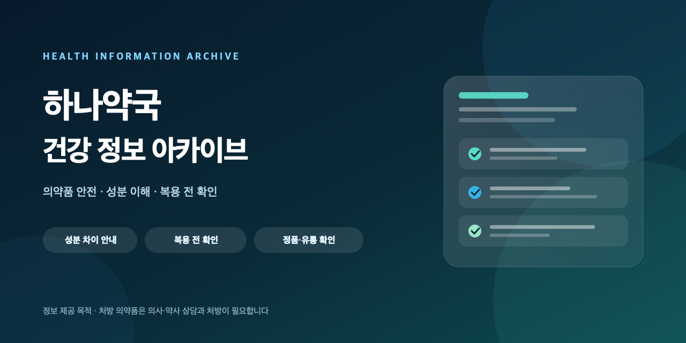

# 하나약국 건강 정보 아카이브



**한국어 건강 정보와 의약품 안전 안내를 정리하는 건강 정보 아카이브입니다.**

> **중요 안내**
> 이 저장소는 건강 정보를 정리하고 공유하기 위한 자료실이며, 의료 진단·처방·판매·주문·배송을 제공하거나 중개하지 않습니다.
> 처방 의약품은 반드시 의사·약사의 상담과 처방을 거쳐 사용해야 합니다.
> 응급 상황이나 개인별 복용 판단은 가까운 의료기관에 문의하세요.

## 소개

의약품과 건강 정보는 검색 결과가 많을수록 오히려 판단하기 어려워집니다. 이 저장소는 공개된 안내 자료를 한국어로 읽기 쉽게 정리하고, **성분 이해 → 복용 전 확인 → 의약품 확인** 순서로 살펴볼 수 있게 구성하는 것을 목표로 합니다.

특정 제품의 효능을 보장하거나 구매를 유도하지 않습니다. 개인의 건강 상태에 따라 적합한 성분과 용법이 달라질 수 있으므로, 모든 내용은 전문가 상담을 보완하는 참고 자료로만 사용해야 합니다.

## 다루는 내용

| 주제 | 설명 | 공개 안내 |
| --- | --- | --- |
| 성분 차이 | 실데나필·타다라필 등 성분별 특징과 차이를 이해하기 위한 안내 | [성분 차이 안내](https://www.hanayakguk.net/page/sildenafil-tadalafil-difference-guide) |
| 3종 비교 | 주요 성분을 같은 기준으로 비교할 때 확인할 항목 | [3종 비교 안내](https://www.hanayakguk.net/page/viagra-cialis-levitra-comparison) |
| 복용 전 확인 | 상호작용, 주의사항, 전문가 상담이 필요한 상황 | [복용 전 확인](https://www.hanayakguk.net/page/ed-medicine-safety-interaction-guide) |
| 의약품 확인 | 수령한 의약품의 포장·표시·보관 상태를 확인하는 절차 | [수령 후 확인 7단계](https://www.hanayakguk.net/page/authenticity-checklist-7-steps) |
| 건강 칼럼 | 건강 관리와 의약품 안전에 관한 공개 칼럼 모음 | [칼럼 보기](https://www.hanayakguk.net/blog) |

> 위 링크는 정보 확인을 위한 공개 안내 페이지입니다. 링크된 사이트의 운영 정책과 콘텐츠는 해당 사이트의 책임입니다.

## 읽는 순서

1. **성분 차이** — 먼저 성분별 특징과 차이를 이해합니다.
2. **3종 비교** — 자신의 상황에서 어떤 기준이 중요한지 정리합니다.
3. **복용 전 확인** — 상호작용과 주의사항을 확인합니다.
4. **의약품 확인** — 포장·표시·보관 상태를 확인하는 절차를 익힙니다.
5. **전문가 상담** — 개인별 판단은 의사·약사와 상담합니다.

## 운영 원칙

- 공개된 공식 자료와 검증 가능한 출처를 우선합니다.
- 개인별 진단, 처방, 복용량 지시를 제공하지 않습니다.
- 효능 보장, 부작용 없음, 100% 안전 같은 단정적 표현을 사용하지 않습니다.
- 가격, 재고, 주문, 배송, 구매 유도 문구를 넣지 않습니다.
- 실제 후기나 전문가 인터뷰를 꾸며내지 않습니다.
- 인용한 자료의 출처와 확인 날짜를 함께 표시하는 것을 원칙으로 합니다.

## 저장소 구조

이 저장소는 공식 사이트의 건강 정보를 정리해 제공하는 정적 사이트입니다.

```
/
├── index.html              # 아카이브 소개
├── archive/                # 전체 글 목록
├── articles/               # 주제별 안내 글
├── assets/                 # 스타일과 이미지
├── sitemap.xml             # 검색엔진용 사이트맵
├── feed.xml                # RSS
└── robots.txt
```

## 기여 안내

정보 오류 제보, 출처 보강, 표현 개선은 환영합니다.

- 공식 기관, 의료기관, 학술 자료 등 확인 가능한 출처를 함께 제시해 주세요.
- 개인 경험이나 특정 제품 추천은 정보 글의 근거로 사용하지 않습니다.
- 판매·구매·배송·가격·효능 보장과 관련된 내용은 받지 않습니다.
- 개인을 식별할 수 있는 건강 정보나 상담 내용은 공유하지 마세요.

## 면책 고지

이 저장소의 내용은 일반적인 정보 제공을 목적으로 하며, 의학적 진단·치료·처방을 대체하지 않습니다. 의약품의 사용 여부와 용법은 반드시 의사·약사의 판단을 따라야 합니다. 내용을 참고해 내린 결정과 그 결과에 대한 책임은 이용자에게 있습니다.

## 참고 기관

- [식품의약품안전처](https://www.mfds.go.kr)
- [질병관리청](https://www.kdca.go.kr)
- [건강보험심사평가원](https://www.hira.or.kr)

## 저작권 및 인용

별도 표기가 없는 문서의 저작권은 운영자에게 있습니다. 인용할 때는 출처와 원문 링크를 함께 표시해 주세요. 이미지의 경우 각 이미지에 표시된 출처와 라이선스를 우선합니다.

---

### English summary

A Korean-language health information archive. It summarizes publicly available guidance on medication safety, ingredient differences, and pre-use checks. It does **not** provide diagnosis, prescriptions, sales, orders, or shipping. Prescription medicines require consultation with a qualified healthcare professional.
